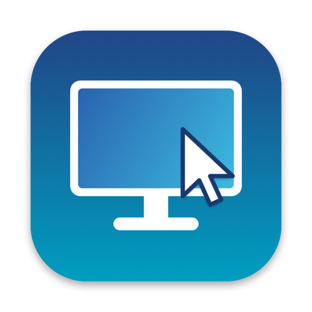
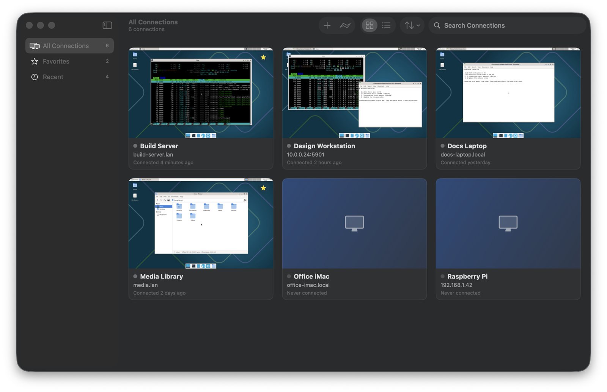
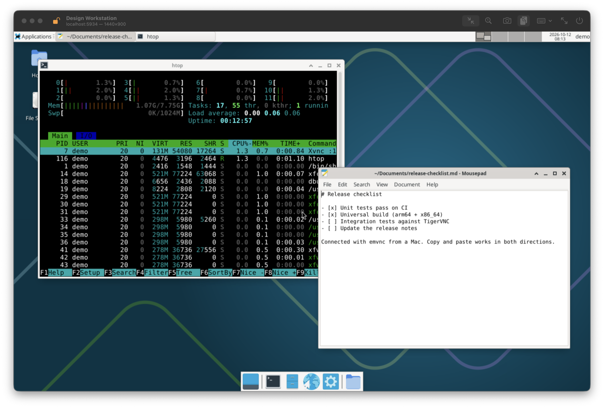

<p align="center">
  
</p>

<h1 align="center">emvnc</h1>

<p align="center">
  A native, open-source VNC viewer for macOS.<br>
  SwiftUI and AppKit on top of a patched <a href="https://github.com/royalapplications/royalvnc">RoyalVNCKit</a> — no Electron, no web views.
</p>

<p align="center">
  <a href="https://github.com/elvisdragonmao/emvnc/releases/latest">Download</a> ·
  <a href="#building">Build from source</a> ·
  <a href="#using-emvnc">Usage</a>
</p>

<p align="center">
  
</p>

- Saved connections with live thumbnails of the last remote screen, favorites, recents, search, grid and list views
- VNC Password, Apple Remote Desktop, UltraVNC MS-Logon II, **RSA-AES / RSA-AES-256 (encrypted sessions)**, or no authentication
- Passwords stored only in the macOS Keychain
- Two-way Unicode text clipboard, scoped to the session you are using
- Keyboard mapping profiles for Mac and Windows/Linux servers, shortcut pass-through, special key combinations
- Fit-to-window and actual-size scaling, full screen, automatic reconnect, screenshot history

<p align="center">
  
</p>

<p align="center"><sub>Screenshots show demo machines: XFCE desktops on TigerVNC in Docker.</sub></p>

## Requirements

- macOS 14 Sonoma or later (developed and tested on macOS 26.6, Apple silicon; release builds are universal)
- To build: Xcode with Swift 6.3 or later (verified with Xcode 27.0; CI uses the `macos-26` image's default Xcode),
  **or** just the Command Line Tools with Swift 6.3+
- Docker, only for the integration tests

## Download

Builds are attached to [GitHub Releases](https://github.com/elvisdragonmao/emvnc/releases). They are signed ad hoc,
not with a Developer ID, and not notarized, so macOS blocks the first launch: open the app once, then choose
*System Settings ▸ Privacy & Security ▸ Open Anyway*. Every push to `main` also produces a build artifact on the
[Actions](https://github.com/elvisdragonmao/emvnc/actions) page.

## Building

### Xcode

Open `emvnc.xcodeproj`, select the **emvnc** scheme and Run. The project signs with "Sign to Run Locally"; set a
team in *Signing & Capabilities* to use your own certificate. The project is generated from `project.yml` with
[XcodeGen](https://github.com/yonaskolb/XcodeGen) (`xcodegen generate`); all app code lives in the local Swift
package `Packages/EmVNCKit`, so the Xcode target only adds the app bundle, icon and `Info.plist`.

### Command line

```sh
scripts/build-app.sh release      # SwiftPM, no Xcode needed → build/emvnc.app (ad-hoc signed, this Mac's architecture)
scripts/build-xcode.sh            # xcodebuild, needs Xcode → build/Release/emvnc.app (universal)
open build/emvnc.app
```

Both accept `VERSION=… BUILD_NUMBER=…`. `swift run --package-path Packages/EmVNCKit emvnc` also starts the app,
without a bundle.

With an open-source toolchain from swift.org (instead of Apple's), add
`-Xswiftc -Xfrontend -Xswiftc -enable-cross-import-overlays` to `swift build`/`swift test`: those toolchains don't
load SwiftData's SwiftUI overlay (`Query`, `.modelContainer`) automatically.

### Tests

```sh
scripts/test.sh                   # unit tests: RoyalVNCKit fork + EmVNCKit (Swift Testing)
scripts/integration-test.sh       # starts TigerVNC in Docker and drives the real engine with vncprobe

# Optionally include a server of your own (e.g. RSA-AES, macOS Screen Sharing):
EXTERNAL_HOST=10.0.0.5 EXTERNAL_USER=me EXTERNAL_PASSWORD=secret scripts/integration-test.sh
```

### Continuous integration

GitHub Actions (`.github/workflows/`):

- **CI** — on every push to `main` and every pull request: unit tests, the SwiftPM app build and the universal
  Xcode build on a `macos-26` runner; the Xcode build is uploaded as an artifact. The Docker integration tests
  are not run there (macOS runners have no Docker).
- **Release** — when a `v*` tag is pushed (`git tag v1.0.0 && git push origin v1.0.0`): tests, a universal Release
  build with the tag as version, then a GitHub release with `emvnc-<version>.zip` and its SHA-256. Tags with a
  hyphen (`v1.1.0-beta.1`) become pre-releases.

`vncprobe` (built from `Packages/EmVNCKit`) is a headless client that uses the same engine as the app — handy for
checking a server: `VNC_PASSWORD=… vncprobe --host 10.0.0.5 --user me --screenshot out.png`.

## Using emvnc

### Connections

- **Add Connection** (⌘N) saves a computer. **Quick Connect** (⌘K) connects without saving.
- Addresses: `host`, `host:5901`, `192.168.1.20`, `fe80::1`, `[fe80::1]:5901`. The default port is 5900.
- Double-click a card (or select it and press Return) to connect. Right-click for Edit, Duplicate, Favorite,
  Screenshots, Copy Address and Delete. Deleting a connection also deletes its Keychain item and screenshots.
- A connection that is already open is brought to the front instead of opening a second window.

### Authentication

| Method | RFB security types | Asks for | Session encrypted |
|---|---|---|---|
| Automatic | any of the below the server offers (None first, then RSA-AES-256, RSA-AES, ARD, MS-Logon II, VNC) | what the server requires | depends |
| No Authentication | 1 | nothing | no |
| VNC Password | 2 | password | no |
| Apple Remote Desktop | 30 | username + password | no (credentials only) |
| RSA-AES (Encrypted) | 129, 5 (and 130, 6) | password, or username + password — the server decides | **yes** (AES-EAX) for 129/5 |
| UltraVNC MS-Logon II | 113 | username + password | no (credentials only) |

When a password is missing or rejected, emvnc asks for it. "Remember password in Keychain" stores it **after**
the server accepts it. For RSA-AES, the server's key fingerprint is remembered on first use; if it changes, emvnc
asks before continuing. Servers offering only VeNCrypt (TLS) are not supported — see limitations.

### The viewer

| Action | Shortcut |
|---|---|
| Disconnect / Reconnect | ⌥⌘W / ⌥⌘R |
| Take screenshot | ⌥⌘S |
| Fit to window / Actual size | ⌥⌘1 / ⌥⌘0 |
| Full screen | ⌃⌘F |
| Send ⌘ shortcuts to the remote (pass-through) | ⌃⌥⌘K |

The lock in the toolbar shows whether the session is encrypted; click it for details (negotiated method, what
the server offered, key fingerprint). Unencrypted sessions show a warning banner (can be turned off in Settings).
In Actual Size, ⌥-scroll pans the local view; plain scrolling goes to the remote computer.

### Keyboard

emvnc sends key presses and releases (X11 keysyms), not just characters, so modifiers and shortcuts work.

| Profile | ⌘ sends | ⌥ sends | ⌃ sends |
|---|---|---|---|
| Mac | Command | Option | Control |
| Windows / Linux (Mac shortcuts) | Ctrl — so ⌘C/⌘V/⌘Z copy, paste, undo | Alt | Ctrl |
| Windows / Linux (PC keys) | Windows / Super | Alt | Ctrl |
| Custom | your choice of Control, Alt, Super, Meta for each key |

- ⌘Q, ⌘H, ⌘M, ⌘\` and ⌘, stay with macOS; ⌥⌘ and ⌃⌘ combinations go to the menus first; everything else goes to
  the remote computer. With pass-through on, only ⌃⌥⌘ combinations stay local.
- Modifier presses are sent lazily, so a shortcut handled by the Mac never leaks a stray ⌘/⌥/⌃ (e.g. a Windows-key
  tap that would open the Start menu). Held keys are released when the window loses focus, so nothing gets stuck.
- Combinations macOS itself intercepts (⌘Tab, Mission Control, your global hotkeys) cannot be captured; use
  **Session ▸ Send Keys** for Ctrl-Alt-Delete, the Windows key, Alt-Tab, Alt-F4, ⌘Tab, ⌘Space and others.

### Clipboard

Text copied on the Mac is sent to the session whose window is focused (and to a session when you switch to it);
text copied on the remote computer lands on the Mac clipboard. Background sessions never receive your clipboard
and cannot overwrite it. Servers that support the Extended Clipboard (verified with TigerVNC) get exact UTF-8; others
get Latin-1 when possible and UTF-8 otherwise. Turn sharing off per connection, or from the toolbar during a session.

### Screenshots

A thumbnail is captured from the remote framebuffer (never your screen) about two seconds after connecting and
again when you disconnect. Manual screenshots are kept in each connection's history (last 30). Files are plain PNGs
in `~/Library/Application Support/emvnc/Screenshots/<connection id>/` without metadata.

## Security notes

- Passwords are stored only in the login Keychain (service `dev.emvnc.emvnc.vnc-password`, one item per
  connection). The SwiftData store holds just the item's reference. Nothing logs credentials; RoyalVNCKit's logger is
  disabled.
- Only RSA-AES and RSA-AES-256 encrypt the session. VNC Password, ARD and MS-Logon II protect the credentials but
  send the screen and keystrokes in the clear — use a VPN or SSH tunnel on untrusted networks.
- The app is not sandboxed. Builds signed ad hoc get a new code signature every build, so after rebuilding macOS
  asks once whether the new build may read the saved passwords. Sign with a stable identity to avoid that.

## Project layout

```
.github/workflows/        CI and release (GitHub Actions)
App/                      Xcode app target: entry point, Info.plist, icon
emvnc.xcodeproj, project.yml
Packages/EmVNCKit/        Swift package with all app code
  Sources/EmVNCCore/      Models (SwiftData), Services (Keychain, screenshots, clipboard), Input (keyboard
                          mapping), Session (connection lifecycle), VNC (engine protocol + RoyalVNCKit adapter)
  Sources/EmVNCUI/        SwiftUI scenes and views; AppKit framebuffer view (Metal) and session windows
  Sources/EmVNCLauncher/  `swift run` entry point
  Sources/vncprobe/       headless test client
  Tests/EmVNCCoreTests/
Packages/RoyalVNCKit/     patched RoyalVNCKit fork — see PATCHES.md
Tests/IntegrationServer/  Docker image for the integration tests
scripts/                  build, test, icon
```

The UI only talks to the `RemoteDesktopEngine` protocol; `RoyalVNCEngine` is the only file that imports
RoyalVNCKit, so another engine can be substituted.

Two build-environment notes: the SwiftData models conform to `PersistentModel` by hand instead of using `@Model`,
and views use `@ViewState` (an alias of SwiftUI's `State` property wrapper) and `Query` as a plain property instead
of the `@State`/`@Query` macros. The macro plugins for those ship only with Xcode; this keeps the project building
with the Command Line Tools as well. Behaviour is the same.

## Known limitations

- **VeNCrypt (TLS)** is not supported (Network.framework cannot start TLS inside an existing connection). Enable
  RSA-AES, VNC Password or ARD on the server instead. Tight security, SASL and RealVNC-only types are not supported.
- Apple Remote Desktop / macOS Screen Sharing and UltraVNC MS-Logon II use RoyalVNCKit's implementations and have
  not been tested against real servers for this release.
- Clipboard is text only (no images, rich text or files). No file transfer, audio, chat or view-only mode.
- Keys are sent as the characters of your Mac keyboard layout. With non-Latin input sources or dead keys, switch
  to an ABC/US layout and use the remote computer's input method.
- Multi-monitor servers are shown as one framebuffer.

## License

Apache License 2.0 — see `LICENSE`. Third-party components and their licenses are listed in
`THIRD_PARTY_NOTICES.md`. Not affiliated with RealVNC or Royal Apps.
